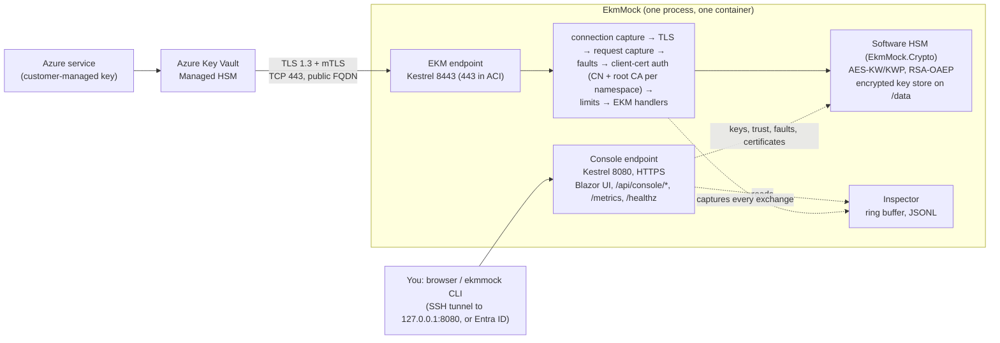

# EkmMock

[](https://github.com/azureholic/ekmmock/actions/workflows/ci.yml)

> **EkmMock is a simulator, not an HSM.** Keys live in software, protected at rest by a master key. There is no tamper resistance, no FIPS validation and no physical custody.
> That is fine for testing how Azure Key Vault Managed HSM behaves with an external key, and it is useless for the compliance reasons external key management (EKM) exists for.
> **Never protect real data with this build.**

EkmMock is one containerised .NET 10 app that Azure Key Vault Managed HSM can register as its **EKM proxy**. To Managed HSM it looks like a vendor EKM proxy plus HSM
(`info`, `metadata`, `wrapkey`, `unwrapkey` over mutual TLS 1.3). Inside, it generates and holds keys and really performs the wrap and unwrap. A browser console shows every call
as it happens. Use it to test EKM end to end: connection set-up, mTLS, wrap/unwrap, the 250 ms latency budget and failure modes.

The full specification is [`spec/ekm-proxy-mockhsm-spec.md`](spec/ekm-proxy-mockhsm-spec.md). What was decided where the spec was open is in [`docs/DECISIONS.md`](docs/DECISIONS.md), what is still unknown
in [`docs/OPEN-QUESTIONS.md`](docs/OPEN-QUESTIONS.md).

**Status:** milestones M1 to M9 are implemented and tested locally and in GitHub Actions. **Nothing has been run against a real Azure Managed HSM yet**: the Azure scripts and templates
are unverified (see [Limitations](#limitations-and-what-is-not-verified)).

## Contents

- [Architecture](#architecture) · [Features](#features) · [Quick start](#quick-start) · [Configuration](#configuration-reference) · [Security notes](#security-notes)
- [CLI](#cli-usage) · [Deployment options](#deployment-options) · [Testing](#testing) · [Performance baseline](#performance-baseline)
- [Limitations](#limitations-and-what-is-not-verified) · [Project layout](#project-layout) · [Documentation](#documentation) · [License](#license)

## Architecture



- **Managed HSM authorises the caller, then calls EkmMock over mTLS.** EkmMock has no Azure identity and makes no Azure authorisation decisions. Managed HSM source IPs are not static, so **client-certificate validation
  (subject CN plus root CA, per namespace) is the only access control**; there is no IP allow-list on the EKM endpoint.
- **Every call must finish within 250 ms**, or Managed HSM gives up. The EKM endpoint must be reachable on **TCP 443**.
- The EKM endpoint and the console are **separate Kestrel endpoints on separate ports**; EKM routes return 404 on the console port and the reverse.
- TLS terminates **in the app**. There is no TLS-terminating front end anywhere in this design: the app has to see the Managed HSM client certificate.

## Features

- **EKM API** (`0.1-preview`): `info`, `metadata`, `wrapkey`, `unwrapkey`; multi-segment path prefixes (several namespaces, each with its own keys and client trust); exact ProxyError bodies; base64url in/out (padded and unpadded accepted).
- **Software HSM**: AES-256 (A256KW, A256KWP) and RSA 2048/3072/4096 (RSA-OAEP-256, RSA-OAEP) with the .NET crypto APIs only (AES-KW per RFC 3394 implemented here, RFC 5649 from the runtime); keys encrypted at rest with AES-256-GCM under a master key; startup self-test.
- **mTLS**: TLS 1.3 only, cipher suites restricted to `TLS_AES_256_GCM_SHA384` and `TLS_AES_128_GCM_SHA256` (enforced by OpenSSL on Linux), custom root trust per namespace, server-certificate hot reload, handshake failures recorded with a reason.
- **Traffic inspector**: every exchange including the rejected ones, with TLS and client-certificate facts, timing waterfall against the 150/250 ms budget, masked DEKs (length and fingerprint only), connection events, JSONL and JSON export, a KQL snippet for the matching Azure-side record.
- **Fluent UI Blazor console**: Live traffic, Exchange detail (with replay), Connections, Dashboard (including the Managed HSM heartbeat), Keys, Namespaces and trust (paste `az keyvault ekm-connection certificate show`), Certificates, Playground, Fault injection, Audit log, About.
- **Fault injection** (opt-in): delay, error rate, HSM offline, key disabled, blackhole, close connection.
- **Metrics and logs**: Prometheus text on the console port, one structured JSON log line per request with no secrets.
- **CLI** (`ekmmock`): init, test PKI, key/namespace/trust management, fault presets, a conformance suite acting as a fake Managed HSM (49 checks covering the 27 acceptance tests), a load test.

## Quick start

You need the .NET 10 SDK (see `global.json`), and Docker for the container flows.

**Windows (PowerShell)**

```powershell
scripts\dev.ps1 dev                 # builds, generates a test PKI, starts the server with sample keys (EKM https://localhost:8443, console https://127.0.0.1:8080)
scripts\dev.ps1 conformance-host    # in another window: the conformance suite against it
# or in Docker:
scripts\dev.ps1 compose-up; scripts\dev.ps1 conformance
```

**Linux / macOS**

```bash
make dev                  # same as above
make conformance-host     # in another shell
# or in Docker:
make compose-up && make conformance
```

Open the console at **https://127.0.0.1:8080**. `--dev` uses a throw-away certificate, so the browser warns; trust `out/dev/pki/root-ca.pem` or accept the warning (loopback only).
`dev` creates the namespace `_default` with the sample keys `aes-key-1` (AES-256) and `rsa-key-1` (RSA-2048) and trusts a **fake Managed HSM client** (CN `test.managedhsmclient.local`), so
`ekmmock test conformance` runs immediately. The expected result is **49 checks: 44 PASS, 0 FAIL, 5 SKIP** (the five that cannot be observed from outside in one run; see
[`docs/RESULTS.md`](docs/RESULTS.md)).

Verified on this project's development machine: `scripts\dev.ps1` targets and `docker compose` (Docker Desktop, Linux engine). The Makefile was only dry-run (`make -n`) in a Linux container; the GitHub Actions
`image-conformance` job runs `make compose-up` and `make conformance` on a Linux runner. The container image could not be built from nuget.org on the development network, see
[`docs/DECISIONS.md`](docs/DECISIONS.md) "Docker build and restore in this environment" (`NUGET_SOURCE`).

For production-like containers see [`deploy/docker/`](deploy/docker/) (`compose.yaml` is the "real" one: master key as a Docker secret file, certificate from `/data/tls`).

## Configuration reference

Settings come from `appsettings.json` and environment variables (`Section__Key`, double underscore). The shipped file is already safe (loopback console, nothing trusted, no sample keys).

| Key | Default | Meaning |
|---|---|---|
| `Endpoints:Ekm:Url` | `https://0.0.0.0:8443` | EKM listener. Publish as 443 (Docker `-p 443:8443`). In ACI there is no port remapping: set `https://0.0.0.0:443`. |
| `Endpoints:Console:Url` | `https://127.0.0.1:8080` | Console listener (HTTPS). |
| `Console:Auth` | `LoopbackOnly` | `LoopbackOnly` (no sign-in; **refuses to start** with a non-loopback bind) or `EntraId` (OIDC; required for any non-loopback bind). |
| `Console:EntraId:TenantId`, `ClientId`, `AllowedObjectIds[]`, `AllowedGroupId` | empty | Entra sign-in and the allow-list. The client secret is **never** configuration (see below). |
| `Console:Tls:CertFile`, `KeyFile` | empty | Separate console certificate; otherwise the EKM server certificate is served. |
| `Console:AllowedHosts[]` | empty | Extra `Host` header values accepted in LoopbackOnly (DNS-rebinding defence); localhost, 127.0.0.1, [::1] are always accepted. |
| `Tls:CertFile`, `Tls:KeyFile`, `Tls:ServerName` | empty | EKM server certificate (PEM chain and key); hot-reloaded on file change and every 60 s. The SAN must equal the FQDN given to `--host`. |
| `Data:Path` | `/data` | Key store, namespaces, audit log, inspector files, certificates, data-protection keys. The only writable place in the container. |
| `SeedNamespaces[]` | `_default`, no trust | Namespaces and client trust seeded at first start. |
| `Limits:LatencyBudgetMs`, `LatencyWarningMs`, `InternalDeadlineMs`, `MaxConcurrency` | 250, 150, 200, 64 | Budget colours and log levels, the internal deadline, the concurrency limit (over it: immediate 429). |
| `Inspector:RingBufferSize`, `Persist`, `SecretDisplay`, ... | 10,000, `false`, `Masked` | Inspector ring buffer, JSONL files (always masked), DEK display mode. |
| `Metrics:AllowAnonymous` | `false` | Whether `/metrics` is served without console auth in EntraId mode. |
| `Faults:BlackholeMaxHoldSeconds` | 600 | Cap on how long a blackholed request is held. |
| `ProxyInfo:*` | `0.1-preview`, "Remco Test", "EkmMock v0.2.0", ... | The five `info` fields. |
| `SelfTest:Strict` | `false` | Refuse to start if a self-test fails. |
| `Dev:Enabled`, `Dev:SeedSampleKeys` | `false` | `--dev` only: throw-away master key and certificate, sample keys. |

**Environment-only settings** (deliberately not configuration, so a file in git cannot enable them):

| Variable | Meaning |
|---|---|
| `EKMMOCK_MASTER_KEY` / `EKMMOCK_MASTER_KEY_FILE` | The key store master key (base64, 32 bytes). Required unless `--dev`. `ekmmock init` creates one. |
| `EKMMOCK_CONSOLE_CLIENT_SECRET` / `EKMMOCK_CONSOLE_CLIENT_SECRET_FILE` | Entra client secret of the console. |
| `EKMMOCK_ENABLE_FAULTS=true` | Allows fault rules (otherwise the page is read-only). |
| `EKMMOCK_INSPECTOR_ALLOW_REVEAL=true` | Allows a per-field, audited "Reveal" of a masked DEK in the console. |
| `EKMMOCK_ALLOW_KEY_IMPORT=true` | Allows importing key material (RFC test vectors only). |
| `EKMMOCK_CONSOLE_CONTAINER_PUBLISH=true` | The container-publish opt-in (see Security notes). Refused outside a container and with `EntraId`. |

Secrets come from environment variables or files (Docker/Kubernetes secrets), never from `appsettings.json`, and are never logged or shown. A client secret found in configuration is refused.

## Security notes

**Trust model.** Managed HSM authenticates with a client certificate. For each namespace EkmMock requires (a) a client certificate, (b) a chain to **that namespace's** root CAs (custom root trust; the OS trust store is not used),
(c) a subject CN that is exactly in **that namespace's** allow-list. Trust is by **CN and root CA, never by fingerprint**, so it survives Microsoft's client-certificate rotation. A missing certificate gets a JSON `401`, an untrusted CA fails the handshake.
The CAs must be **self-signed roots** (an issuing CA listed instead of its root authenticates nobody; [OQ 18](docs/OPEN-QUESTIONS.md)).

**Secrets never leave the crypto engine.** No API, page, export, log line or error message contains key material; tests scan all console responses, logs and exports for every key in raw, base64, base64url and hex. The one plaintext that leaves is the DEK in an
`unwrapkey` response, because the contract requires it; the inspector masks it (length and a 12-hex-character SHA-256 fingerprint).

**The limits of managed memory (spec 5.2).** DEKs that EkmMock owns (pooled request buffers, key material in the engine) are zeroed with `CryptographicOperations.ZeroMemory`, best effort. That is not a guarantee: strings cannot be zeroed, the .NET runtime
and the HTTP/TLS stack can copy bytes they own (GC compaction, socket and TLS buffers), the OS can swap pages or write a crash dump, and "Reveal" necessarily produces a string. Treat a compromised host as a compromise of every key it ever used.
This is another reason EkmMock is a test tool.

**Console exposure.** The console is an unauthenticated admin UI in `LoopbackOnly`. It must stay on loopback: reach it through `ssh -L 8080:127.0.0.1:8080` or a loopback-only Docker publish. Inside a container a loopback-only bind cannot be reached from a published port, which
conflicts with the spec's own rules, so there is **one explicit, narrow opt-in**: `EKMMOCK_CONSOLE_CONTAINER_PUBLISH=true` allows the console to listen on the container's address, only in `LoopbackOnly`, only when running in a container, with a startup warning, a banner on every page and a
source-address check that refuses public sources ([DECISIONS](docs/DECISIONS.md) "Container-safe console binding"). **Residual risk: if you publish the port on `0.0.0.0` instead of `127.0.0.1`, anyone on your network segment gets an unauthenticated admin console.** The primary control is the host side of the
port mapping; both compose files and the VM template hard-code `127.0.0.1`. For a console that must be reachable from other machines use `Console:Auth=EntraId` (ACI).

**Platform notes.** Cipher-suite enforcement works where the TLS stack supports `CipherSuitesPolicy` (Linux/OpenSSL, the container). On Windows (SChannel) the policy is unsupported: EkmMock logs a warning and closes connections that negotiated another suite *after* the handshake
(verified only for what SChannel negotiated in testing). On Windows, TLS certificates are persisted CNG key files (removed when the certificate is disposed): test runs and `ekmmock certs` can leave files in `%APPDATA%\Microsoft\Crypto\Keys` and CA certificates in the current user's store
([OQ 25, 46, 56](docs/OPEN-QUESTIONS.md)). The Linux container is the production target.

**What is not protected.** No tamper resistance, no HSM-grade custody, no replication. The master key protects the key store file; **losing it makes every key unrecoverable**, and master-key rotation is not supported. Data-protection keys on the volume are not encrypted ([OQ 63](docs/OPEN-QUESTIONS.md)).

## CLI usage

```text
ekmmock init --data ./data                                  master key (owner-only) and data folders
ekmmock certs dev|ca|server|client ...                      TEST PKI only
ekmmock key list|show|create|enable|disable|expire|destroy  keys of a running server (console API)
ekmmock ns list|create|delete                               namespaces
ekmmock trust import --ns _default --json mhsm-client.json  Managed HSM client trust (output of `az keyvault ekm-connection certificate show`)
ekmmock faults list|preset|delete|clear                     fault injection presets
ekmmock test conformance --url https://<fqdn> --client-cert ... --client-key ... --ca root-ca.pem
ekmmock test bench --url ... --op unwrapkey --key aes-key-1 --alg A256KWP --concurrency 16 --duration 60s
ekmmock health [--ready]                                    the container health probe
```

Exit codes: `0` success, `1` failure (action refused, a test or threshold failed), `2` usage error, `3` connection or authentication error. Every command has `--help` with examples. Console access: `--console`, `--console-ca`, `--console-pin`,
`--insecure-console-cert` (loopback only), `--auth entra` (device code) or `EKMMOCK_CONSOLE_TOKEN`. Secret material is never printed. Run `ekmmock <command> --help` for the options.

## Deployment options

| Option | Status | Notes |
|---|---|---|
| **Linux VM with Docker** ([`deploy/azure/vm.bicep`](deploy/azure/vm.bicep)) | **Recommended** | Public IP with DNS label, NSG (443 from anywhere, 22 from your IP only), console on the VM loopback via an SSH tunnel, cloud-init, test certificate generated on the VM for the FQDN. Template validated offline only. |
| **Azure Container Instances** ([`deploy/azure/aci.bicep`](deploy/azure/aci.bicep)) | Alternative, **unverified** | TCP pass-through with Azure Files for `/data`; EKM on 443 inside the container; console on a second public port with Entra ID. Binding 443 as non-root, SMB file semantics and `runAsRoot` are unverified ([OQ 6](docs/OPEN-QUESTIONS.md)); no read-only root file system. |
| Docker / Compose on your own host | Supported | [`deploy/docker/`](deploy/docker/); the image is built from the repository (no image is published). |
| App Service, AKS, Container Apps, Application Gateway, Front Door, any TLS-terminating ingress | **Not supported** | The app must see the Managed HSM client certificate itself. |
| Azure Private Link | Out of scope | The SAN name is configurable so that it can be added later (spec 11.4). |

Commands, prerequisites, regions and clean-up: [`deploy/azure/README.md`](deploy/azure/README.md). The end-to-end test against a real Managed HSM is [`deploy/azure/e2e.sh`](deploy/azure/e2e.sh) (**unverified against a real Managed HSM**; `--dry-run` shows every command). Operating it: [`docs/RUNBOOK.md`](docs/RUNBOOK.md).

## Testing

```bash
dotnet build EkmMock.sln -warnaserror
dotnet test --solution EkmMock.sln                                   # everything, including the Playwright browser tests
dotnet test --solution EkmMock.sln --filter-not-trait "Category=Browser"   # what CI runs on the main jobs
```

Four test projects (xUnit v3, Shouldly, bUnit, Playwright): `EkmMock.Crypto.Tests`, `EkmMock.Server.Tests` (real-Kestrel mTLS tests with generated certificates, inspector, leak scan), `EkmMock.Console.Tests`, `EkmMock.Cli.Tests`.
**Platform-specific tests:** four `CipherPolicyTests.Linux_*` tests need OpenSSL and are skipped on Windows; the Windows-only CNG key-container tests are skipped on Linux; the browser tests (`Category=Browser`, Chromium) run in their own CI job. `tests/run-server-tests-linux.ps1` runs the server tests in a Linux container from Windows.

**What CI runs** ([`ci.yml`](.github/workflows/ci.yml)): Linux build with warnings as errors, tests and a NuGet vulnerability scan; Windows build and tests; browser tests; the image build plus the conformance suite and a restart test against the container; and a Bicep build and lint of both Azure templates.
Last local totals and the mapping of the 27 acceptance tests to the tests that prove them: [`docs/RESULTS.md`](docs/RESULTS.md).

## Performance baseline

Measured with `ekmmock test bench`, Release build, `--dev`, TLS 1.3 + mTLS **over loopback with the client on the same machine** (Intel i7-9700K, 8 logical CPUs, Windows 10.0.26300, .NET 10.0.14, **a shared developer machine** with other programs running), concurrency 16, 60 s, one kept-alive HTTP/1.1 connection per worker, 32-byte DEK. Raw files in [`docs/benchmarks/`](docs/benchmarks/).

| Operation | req/s | p50 | p99 | max | > 250 ms | Spec target (p99) |
|---|---:|---:|---:|---:|---:|---|
| AES `unwrapkey` A256KWP | 30,221 | 0.41 ms | 1.56 ms | 327 ms | 16 of 1,813,291 | < 10 ms: met |
| RSA-2048 `unwrapkey` | 9,367 | 1.45 ms | 4.32 ms | 340 ms | 16 of 562,028 | < 30 ms: met |
| RSA-4096 `unwrapkey` | 1,894 | 8.19 ms | 18.7 ms | 171 ms | 0 | < 100 ms: met |
| `info` | 32,625 | 0.37 ms | 1.62 ms | 315 ms | 16 of 1,957,493 | < 5 ms: met |

**Honest caveats.** (1) The spec's "0 % over 250 ms" is **not strictly met**: 0.001 % to 0.003 % of the requests (one cluster of 16 at once, about every 10 s at 30k req/s) take 100 to 340 ms. The cause is not isolated; client and server share the 8 CPUs, which is the leading suspect, and it has to be
re-measured with the client on another machine. (2) An **open loop** (which corrects coordinated omission) at 1,000 req/s gives an AES p99 of 5.5 ms; at **5,000 req/s the p99 is 36 ms**, above the 10 ms target, with nothing over 250 ms. A real Managed HSM sends far fewer requests per second. (3) Not measured on the 2-vCPU Azure target.
Two real inefficiencies were found and fixed by this measurement (a per-request certificate chain build, a blocking console logger): 331 req/s before, about 30,000 now.

## Limitations and what is not verified

- **No run against a real Azure Managed HSM.** Everything about how Managed HSM behaves (padded base64url, `alg` per service, HTTP version and connection reuse, behaviour at 429/5xx/blackhole, the failure point of the latency sweep) is an open question to be answered by [`deploy/azure/e2e.sh`](deploy/azure/e2e.sh) and recorded in [`docs/RESULTS.md`](docs/RESULTS.md).
- **Not verified in Azure at all:** both Bicep templates (built and linted offline only; no deployment), the VM boot flow (cloud-init, Docker install, certificate generation on the VM), ACI (binding 443 as non-root, SMB mount semantics, whether `runAsUser` is accepted), and the exact behaviour of the `az keyvault ekm-connection` commands (they exist in Azure CLI 2.92, syntax taken from `--help` and Learn).
- **No real Entra tenant:** the console's OIDC sign-in and the CLI's device-code sign-in were tested with fake handlers and locally signed tokens only ([OQ 34, 53](docs/OPEN-QUESTIONS.md)).
- **Windows cipher enforcement** is a post-handshake check, not a handshake policy; the full TLS 1.3 suite enforcement is verified on Linux only.
- Master-key rotation, key backup/restore, high availability, Private Link IaC and a real-HSM backend are out of scope (spec 1).
- The Makefile was dry-run only; `docker scan`/Trivy of the image was not run.

## Project layout

```text
src/EkmMock.Crypto/       software HSM engine: AES-KW/KWP, key store, namespaces, self-test (no ASP.NET dependency)
src/EkmMock.Pki/          test PKI generation (used by `ekmmock certs` and the dev mode)
src/EkmMock.Server/       Kestrel host, EKM endpoint, mTLS, auth, limits, faults, inspector, metrics, console API
src/EkmMock.Server/Console/  Blazor components and pages (Fluent UI)
src/EkmMock.Cli/          ekmmock tool (System.CommandLine)
tests/                    EkmMock.Crypto.Tests, EkmMock.Server.Tests, EkmMock.Console.Tests, EkmMock.Cli.Tests, EkmMock.TestSupport
deploy/docker/            Dockerfile, compose.yaml (real), compose.dev.yaml (laptop try-out)
deploy/azure/             vm.bicep, aci.bicep, cloud-init.yaml, vm-setup.sh, e2e.sh, example parameter files, README
docs/                     RUNBOOK, RESULTS, DECISIONS, OPEN-QUESTIONS, benchmarks/
scripts/dev.ps1, Makefile developer targets (same names)
Directory.Packages.props, EkmMock.sln
```

## Documentation

- [`docs/RUNBOOK.md`](docs/RUNBOOK.md): operating guide, master key custody, certificate renewal, trust rotation, KQL for the Managed HSM diagnostic logs, troubleshooting, clean-up order.
- [`docs/RESULTS.md`](docs/RESULTS.md): measured local verification and the Azure end-to-end template (every Azure cell says `NOT YET MEASURED`).
- [`docs/DECISIONS.md`](docs/DECISIONS.md): implementation decisions per milestone. [`docs/OPEN-QUESTIONS.md`](docs/OPEN-QUESTIONS.md): what is unknown or conflicts with Learn.
- [`deploy/azure/README.md`](deploy/azure/README.md): deploying the VM or ACI. [`spec/ekm-proxy-mockhsm-spec.md`](spec/ekm-proxy-mockhsm-spec.md): the specification.
- Microsoft Learn: [What is Managed HSM external key management?](https://learn.microsoft.com/azure/key-vault/managed-hsm/external-key-management-overview),
  [Networking and mTLS](https://learn.microsoft.com/azure/key-vault/managed-hsm/external-key-management-networking),
  [Quickstart (Azure CLI)](https://learn.microsoft.com/azure/key-vault/managed-hsm/external-key-management-quickstart-cli),
  [Logging and monitoring](https://learn.microsoft.com/azure/key-vault/managed-hsm/external-key-management-logging-monitoring).

## License

**License: not yet chosen.** The repository has no `LICENSE` file, so by default all rights are reserved by the author; the owner has to decide. (The container image label `org.opencontainers.image.licenses` says `NOASSERTION` for the same reason.)
The Copilot customization files imported under `.github/` (agents, instructions, prompts, skills from [awesome-copilot](https://github.com/github/awesome-copilot)) are MIT-licensed; their notice is in [`.github/awesome-copilot/LICENSE`](.github/awesome-copilot/LICENSE).
